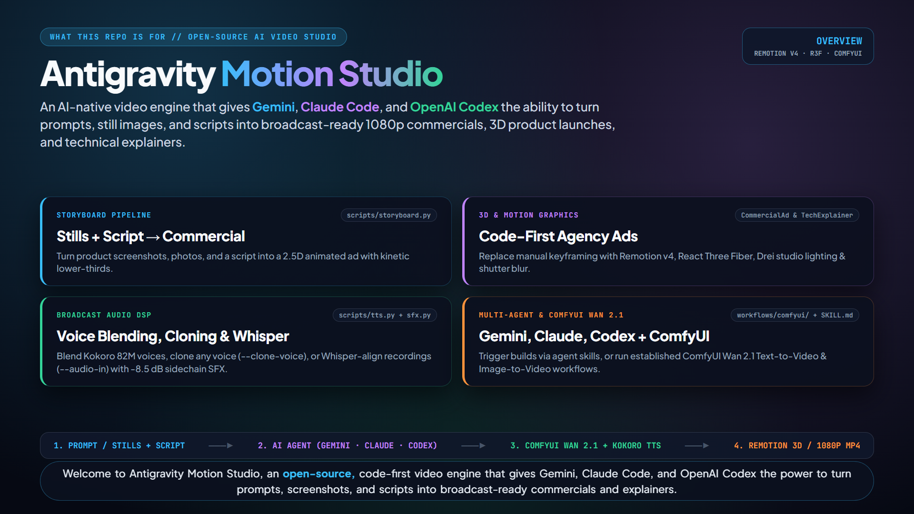
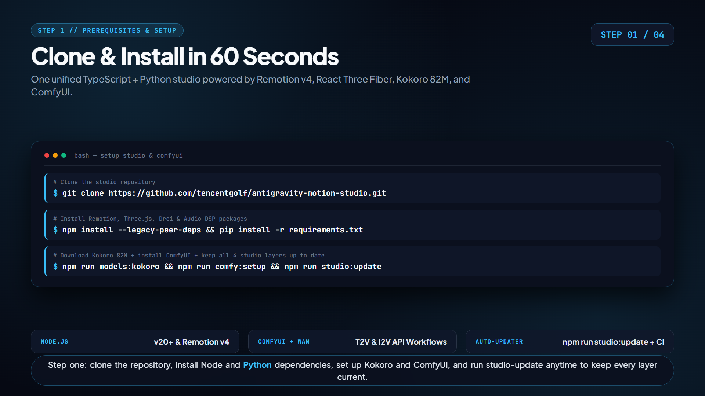
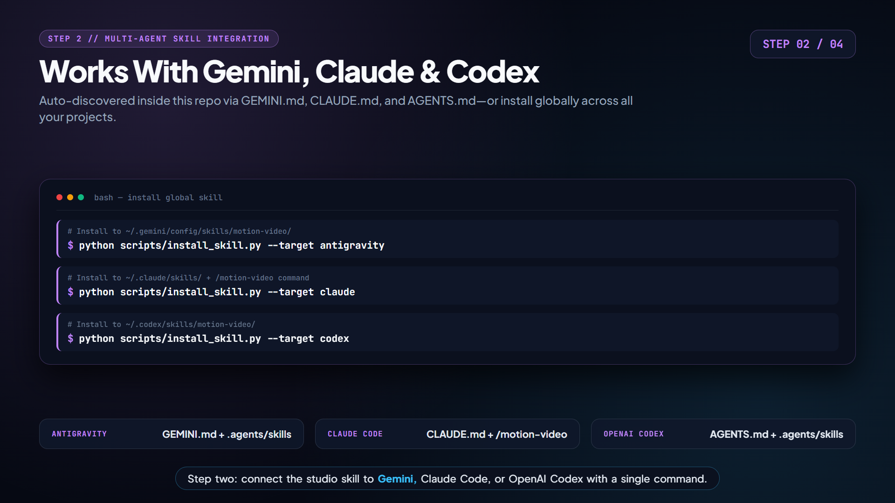
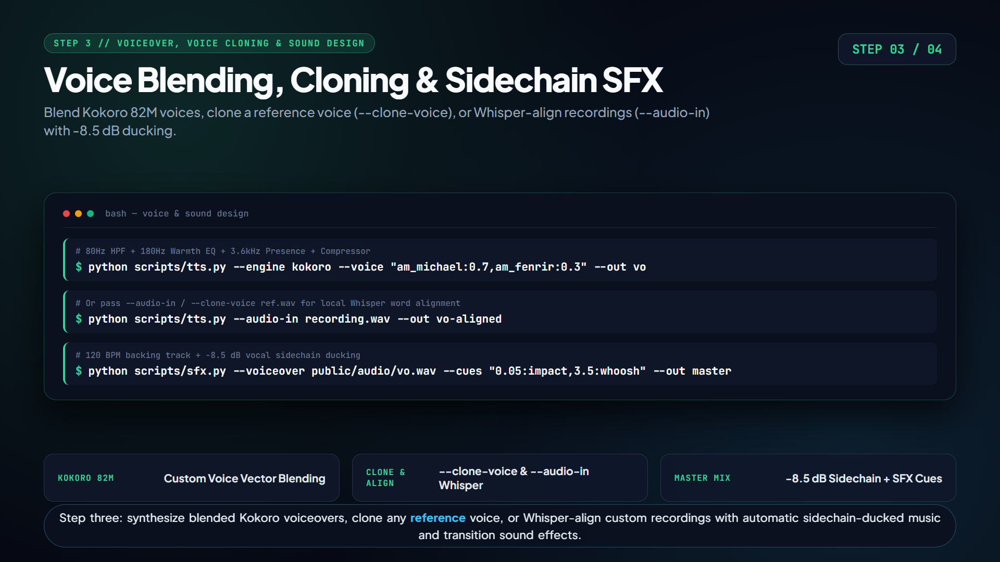
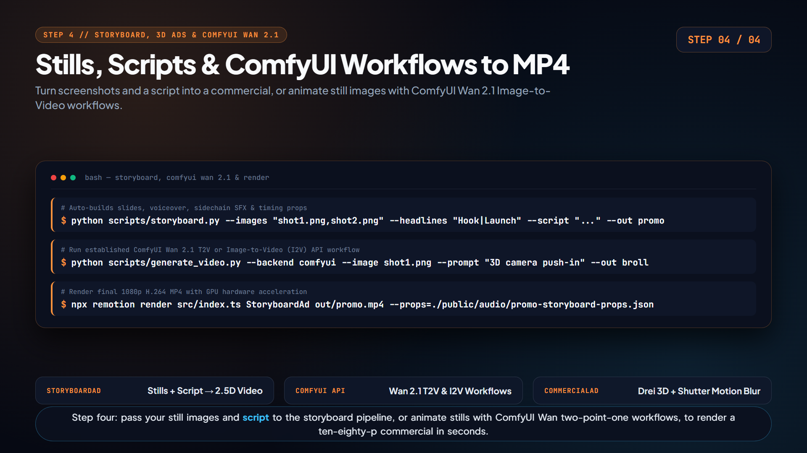

# Antigravity Motion Studio

An AI-native, code-first motion graphics and commercial video studio built for **Google Antigravity (Gemini)**, **Claude Code**, and **OpenAI Codex**.

Replace manual After Effects keyframing with deterministic **Remotion v4**, **React Three Fiber (`@remotion/three` + `@react-three/drei`)**, **Kokoro 82M / Edge Neural TTS**, **Automated Sidechain Audio & SFX Mixing**, and **Local AI Video Generation (`Wan 2.1`)**.

---

## Instructional Video & Visual Walkthrough

> **Watch the full Instructional Video with Opener + 4-Step Walkthrough (built & rendered by this repo):**
> [**`docs/previews/studio-guide.mp4`**](docs/previews/studio-guide.mp4)

### Opener: What Antigravity Motion Studio Is For


### 4-Step Setup & Video Creation Walkthrough
| Step 1: Clone & Install in 60s | Step 2: Gemini, Claude & Codex Skills |
| :---: | :---: |
|  |  |
| **Step 3: Human Voice Blending & Sidechain SFX** | **Step 4: Still Images + Script → 1080p MP4** |
|  |  |

---

## What's Inside

1. **8 Production-Ready Remotion Compositions (`src/compositions/`):**
   * `StudioGuide.tsx` (`1920x1080`): Official repository opener + 4-step instructional walkthrough synced to Kokoro voiceover and sidechain-ducked audio.
   * `StoryboardAd.tsx` (`1920x1080`): Turn any list of **still images + a script/storyline** into an animated 2.5D commercial with automatic transitions, kinetic lower-thirds, voiceover, and sidechain-ducked music.
   * `CommercialAd.tsx` (`1920x1080`): Multi-scene agency product launch ad using `<TransitionSeries>`, `<CameraMotionBlur>`, `@remotion/google-fonts`, `@remotion/paths` (`evolvePath`), `@remotion/noise`, and `@react-three/drei` 3D materials.
   * `TechExplainer.tsx` (`1920x1080`): Step-by-step animated architecture diagrams & live code walkthroughs.
   * `SocialShort.tsx` (`1080x1920` 9:16 vertical): TikTok/Reels/Shorts kinetic word-by-word captions with an audio-reactive spectrum bar.
   * `ThreeVisualizer.tsx` (`1920x1080`): Deterministic 3D WebGL visualizer powered by `@remotion/three`.
   * `HalloweenExplainer.tsx` (`1920x1080`): Multi-chapter cultural/historical explainer locked to voiceover segments.
   * `AiVideoShowcase.tsx` (`1920x1080`): Composites local AI video clips (`<OffthreadVideo>`) with vignette grading, HUD typography, and reactive waveform bars.

2. **Broadcast Voiceover, Sound Design & AI Video CLI (`scripts/`):**
   * `scripts/storyboard.py`: One-command builder from still images + narration script to ready-to-render Remotion props.
   * `scripts/tts.py`: Multi-engine voiceover generator (**Kokoro 82M ONNX** with custom multi-voice blending, **Edge Neural TTS** with hardware `WordBoundary` timestamps, **`--audio-in`** to ingest & Whisper-align any custom microphone/VoiceStudio recording, and **`--clone-voice`** for zero-shot local GPU voice cloning via `F5-TTS`/`ChatterboxTTS`) plus a built-in **Broadcast Vocal DSP Chain** (80Hz high-pass, 180Hz warmth EQ, 3.6kHz presence boost, soft-knee 2.5:1 compression, `-1.0 dBFS` limiter).
   * `scripts/sfx.py`: Procedural 120+ BPM electronic backing beat, frame-locked transition SFX (`impact`, `whoosh`, `shimmer`), and **automatic `-8.5 dB` sidechain ducking** under the voiceover.
   * `scripts/generate_video.py`: Dual-backend local AI video generator supporting **established ComfyUI Wan 2.1 workflows** (`workflows/comfyui/wan21_t2v_api.json` for Text-to-Video & `workflows/comfyui/wan21_i2v_api.json` for **Image-to-Video**) as well as standalone Hugging Face `diffusers` (`Wan-AI/Wan2.1-T2V-1.3B-Diffusers`) with optional optical-flow frame interpolation (`--fps-upsample 32`).
   * `scripts/setup_comfyui.py`: One-command installer & headless launcher (`npm run comfy:setup` / `npm run comfy:serve`) for local **ComfyUI + VideoHelperSuite**.
   * `scripts/update_studio.py`: One-command updater (`npm run studio:update`) that upgrades `@remotion/*` packages in lockstep, updates Python packages while preserving CUDA `torch`, pulls the latest ComfyUI & custom nodes, and syncs installed global agent skills.

---

## Prerequisites & Installation

### 1. System Prerequisites
* **Node.js:** `v20+` (tested on `v24.x`)
* **Python:** `3.10+` (tested on `3.12`)
* **GPU (Recommended):** NVIDIA RTX GPU (8 GB+ VRAM for WebGL & Kokoro; 12 GB+ VRAM if using local `Wan 2.1` AI video generation).

### 2. Clone & Install Dependencies
```bash
git clone https://github.com/tencentgolf/antigravity-motion-studio.git
cd antigravity-motion-studio

# 1. Install Node / Remotion / Three.js packages
npm install --legacy-peer-deps

# 2. Install Python TTS & Audio DSP packages
pip install -r requirements.txt

# 3. Download Local Kokoro 82M ONNX Voice Weights (~350 MB into models/)
npm run models:kokoro

# 4. Install Local ComfyUI + VideoHelperSuite (into vendor/ComfyUI)
npm run comfy:setup
```

*(Optional — Local AI Video Generation on NVIDIA GPU):*
Ensure PyTorch with CUDA is installed, and launch the local ComfyUI API server whenever running ComfyUI `Wan 2.1` Text-to-Video (`T2V`) or Image-to-Video (`I2V`) workflows:
```bash
pip install --force-reinstall torch torchvision --index-url https://download.pytorch.org/whl/cu126
npm run comfy:serve
```

---

## Installing the Skill (Antigravity / Gemini, Claude Code, Codex)

### 1. In-Repo Auto-Discovery (Zero Configuration Required)
This repository already includes native configuration files and skills for all three major AI coding agents—simply open the cloned folder in your agent of choice:

* **Google Antigravity / Gemini CLI:** Automatically loads [`GEMINI.md`](GEMINI.md) and [`.agents/skills/motion-video/SKILL.md`](.agents/skills/motion-video/SKILL.md).
* **Claude Code:** Automatically loads [`CLAUDE.md`](CLAUDE.md), [`.claude/skills/motion-video/SKILL.md`](.claude/skills/motion-video/SKILL.md), and the project slash command `/motion-video` ([`.claude/commands/motion-video.md`](.claude/commands/motion-video.md)).
* **OpenAI Codex:** Automatically loads [`AGENTS.md`](AGENTS.md) and [`.agents/skills/motion-video/SKILL.md`](.agents/skills/motion-video/SKILL.md).

### 2. Global Skill Installation (Use From Any Other Project)
If you want to ask your AI coding agent to create a video **while working inside a different project or repository**, install the global skill pointing to your local clone of this studio:

* **Google Antigravity / Gemini CLI (`~/.gemini/config/skills/motion-video/SKILL.md`):**
  ```bash
  python scripts/install_skill.py --target antigravity
  ```
* **Claude Code (`~/.claude/skills/motion-video/SKILL.md` + global `/motion-video` command):**
  ```bash
  python scripts/install_skill.py --target claude
  ```
* **OpenAI Codex CLI (`~/.codex/skills/motion-video/SKILL.md`):**
  ```bash
  python scripts/install_skill.py --target codex
  ```
* **Install for All Three at Once:**
  ```bash
  python scripts/install_skill.py --target all
  ```

---

## How to Make a Video

### Workflow 1: Turn Still Images + a Script/Storyline into a Video (`StoryboardAd`)
Have product screenshots, UI mockups, or photos? Give them to your agent (or run via CLI) with a headline per image and a script (one sentence per image):

```bash
# 1. Build voiceover, sidechain-ducked music, transition whooshes, and slide props
python scripts/storyboard.py \
  --images "docs/previews/step1-setup.png,docs/previews/step2-skills.png,docs/previews/step3-audio.png" \
  --headlines "1. One-Minute Setup|2. Multi-Agent Skills|3. Broadcast Audio DSP" \
  --script "Clone the studio and install dependencies in sixty seconds. Connect the skill to Gemini, Claude Code, or Codex. Then render broadcast voiceovers with automatic sidechain ducking." \
  --brand "ANTIGRAVITY" \
  --out my-promo

# 2. Render the final 1080p MP4
npx remotion render src/index.ts StoryboardAd out/my-promo.mp4 --props=./public/audio/my-promo-storyboard-props.json
```

### Workflow 2: Multi-Scene Agency Commercial (`CommercialAd`)
```bash
# 1. Generate voiceover (Blended Male Kokoro Voice: 70% Michael + 30% Fenrir)
python scripts/tts.py \
  --engine kokoro \
  --voice "am_michael:0.7,am_fenrir:0.3" \
  --text "Stop keyframing timelines by hand. Render studio 3D hardware, vector telemetry, and local AI video directly from TypeScript. Ship your next launch with Hyperion." \
  --out ad-voice

# 2. Mix backing beat + automatic -8.5 dB sidechain ducking + frame-locked SFX cues
python scripts/sfx.py \
  --voiceover public/audio/ad-voice.wav \
  --cues "0.05:impact,3.35:whoosh,3.5:shimmer,6.9:whoosh,10.2:whoosh,10.35:impact,10.45:shimmer" \
  --out ad-master

# 3. Render the commercial MP4
npx remotion render src/index.ts CommercialAd out/commercial-ad.mp4 --props=./public/audio/ad-master-props.json
```

### Workflow 3: 9:16 Vertical Social Short (`SocialShort`)
```bash
# Generate voiceover with exact millisecond WordBoundary timestamps
python scripts/tts.py \
  --engine edge \
  --voice en-US-AndrewMultilingualNeural \
  --text "Stop keyframing by hand. Write TypeScript, sync local AI voice, and render at 60fps." \
  --out voiceover

# Render 1080x1920 vertical MP4
npx remotion render src/index.ts SocialShort out/social-short.mp4 --props=./public/audio/voiceover-props.json
```

### Workflow 3b: Custom Recording Ingest (`--audio-in`) & Zero-Shot Voice Cloning (`--clone-voice`)
```bash
# Option A: Bring your own microphone recording or VoiceStudio export (auto-applies Broadcast EQ + Whisper word alignment)
python scripts/tts.py --audio-in path/to/my_recording.wav --out custom-vo

# Option B: Clone any voice locally from a 5-15s reference WAV (via F5-TTS or ChatterboxTTS + Whisper word alignment)
python scripts/tts.py --clone-voice path/to/my_voice_10s.wav --text "Narrated in my cloned voice." --out cloned-vo
```

### Workflow 4: Local AI Video Generation (`ComfyUI Wan 2.1 T2V / I2V` + `AiVideoShowcase`)
```bash
# 1a. Text-to-Video (auto-uses ComfyUI workflow `workflows/comfyui/wan21_t2v_api.json` if server is running, or Diffusers fallback)
python scripts/generate_video.py \
  --prompt "Cinematic video of turquoise ocean waves rolling onto a tropical island beach at golden hour, swaying palm trees, photorealistic, 4k" \
  --aspect 16:9 \
  --frames 49 \
  --fps-upsample 32 \
  --out tropical-clip

# 1b. Image-to-Video (animate any still image via ComfyUI `workflows/comfyui/wan21_i2v_api.json`)
python scripts/generate_video.py \
  --backend comfyui \
  --image docs/previews/step1-setup.png \
  --prompt "Smooth 3D camera push-in with subtle neon reflections" \
  --out step1-motion

# 2. Composite HUD + audio spectrum in Remotion
npx remotion render src/index.ts AiVideoShowcase out/tropical-showcase.mp4 --props=./public/video/tropical-clip-props.json
```

### Workflow 5: Interactive Timeline Preview (Remotion Studio)
To scrub frames, tweak props, and preview compositions live in your browser with hot reload:
```bash
npm run dev
```

---

## Prompting Your AI Agent (From Any Project)

Once you've run `python scripts/install_skill.py --target all`, you can open **Antigravity**, **Claude Code**, or **Codex** in *any* project folder and simply prompt:

* **From Still Images + Script:**
  > *"Take `./screenshots/dashboard.png`, `./screenshots/analytics.png`, and `./screenshots/mobile.png` and make a 15-second product promo video with this script: '...'"*
* **Custom Explainer or Commercial:**
  > *"Create a 20-second technical explainer video showing how our authentication pipeline works and save it to `./promo.mp4`."*

---

## Keeping the Studio Up to Date

1. **Automated GitHub Updates (`.github/dependabot.yml` + `.github/workflows/ci.yml`):**
   * GitHub Dependabot automatically checks `npm` (`package.json`), `pip` (`requirements.txt`), and GitHub Actions weekly, grouping all `@remotion/*` packages into a single lockstep PR and running CI typechecking (`npm run typecheck` + Python validation) automatically.
2. **One-Command Local Machine Update (`npm run studio:update`):**
   * Run `npm run studio:update` (or `python scripts/update_studio.py`) anytime to upgrade `@remotion/*` packages in lockstep, update Python TTS/Whisper/AI packages (without overwriting your CUDA PyTorch build), pull the latest `ComfyUI` + `ComfyUI-VideoHelperSuite` commits, and re-sync your installed global agent skills.
